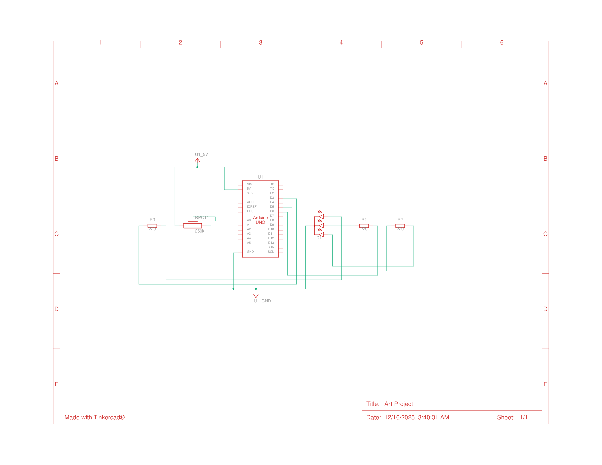

# Arduino-Unity Kaleidoscope Controller

A small graphics co-design prototype that links an Arduino input/output loop with a Unity scene. The Arduino firmware streams raw potentiometer data over serial and accepts RGB values from Unity to drive a physical LED. On the Unity side, C# scripts read the serial stream, map it into a normalized control signal, drive a kaleidoscope shader, and sample rendered color back into the Arduino LED output.

The original project/course blog can be found here: [IGME 470 blog](https://samayrshah.github.io/igme-470/)

## Demo

[Project Demo](https://youtube.com/watch?v=WigIWQmiSRg)

## Core Components & Features

* **Arduino Serial Firmware:** Reads a potentiometer from `A0` with `analogRead`, sends raw values to Unity at `9600` baud, and parses newline-delimited `R,G,B` commands to update the RGB LED on PWM pins `3`, `6`, and `5`.
* **Unity Threaded Serial Bridge:** `ArduinoInput.cs` manages the serial port with a background read thread, uses a lock-protected cache for the latest serial line, and exposes processed values such as `RawPotentiometerValue` and `TwistValue`.
* **Kaleidoscope Control Loop:** `KalleidoscopeControlller.cs` converts the normalized twist input into a shader parameter that adjusts the kaleidoscope segment count in real time.
* **Camera Motion:** `CameraSpinner.cs` adds a simple continuous camera rotation for a more dynamic presentation.
* **LED Color Feedback:** `RGBController.cs` reads from a render texture, downsamples the frame through a configurable sampling step, buckets pixels in HSV space to estimate the dominant color, smooths the result over time, and sends it back to the Arduino as RGB values.
* **Reusable Data Asset:** `FloatContainer.cs` provides a small ScriptableObject wrapper for shared float values.
* **Kaleidoscope Material** Shadergraph implementation of kaleidoscope shader

## Build & Run

### Parts List

|Name      |Quantity|Component           |
|----------|--------|--------------------|
|U1        |1       |Arduino Uno R3      |
|Rpot1     |1       |250 kΩ Potentiometer|
|R2, R3, R1|3       |220 Ω Resistor      |
|D1        |1       |RCBG LED RGB        |

### Schematics

### Arduino Firmware

1. Open `ArduinoFirmware/ArduinoFirmware.ino` in the Arduino IDE.
2. Upload it to the board.
3. Confirm the serial baud rate is `9600`.
* The Unity serial port defaults to `COM3` in `ArduinoInput.cs` and should be changed if your device uses a different port.

### Unity Project

1. Open `UnityArduioProject` in Unity, and open the `Kaleidoscope scene`.
2. Make sure the `ArduinoInput` component has the correct serial port name for your machine.

## Data Flow

1. The Arduino samples the potentiometer and sends the raw analog value to Unity.
2. Unity reads the latest serial line on a background thread and converts it into a twist value.
3. The kaleidoscope controller maps that twist to the shader segment count.
4. The rendered frame is sampled to estimate a dominant color.
5. Unity sends the resulting RGB value back to the Arduino to update the LED.

## Project Structure & Links to relevant scripts

<pre>
├── ArduinoFirmware/
│   └── <a href="./ArduinoFirmware/ArduinoFirmware.ino">ArduinoFirmware.ino</a>       # Arduino firmware for potentiometer input and RGB LED output
├── UnityArduioProject/
│   └── Assets/
│       ├── Scenes/               # Unity scenes, including the kaleidoscope scene
│       ├── Scripts/
│       │   ├── <a href="./UnityArduioProject/Assets/Scripts/Input/ArduinoInput.cs">Input/ArduinoInput.cs</a>             # Serial bridge and value mapping
│       │   ├── <a href="./UnityArduioProject/Assets/Scripts/Game/CameraSpinner.cs">Game/CameraSpinner.cs</a>             # Simple camera rotation behavior
│       │   ├── <a href="./UnityArduioProject/Assets/Scripts/Game/KalleidoscopeControlller.cs">Game/KalleidoscopeControlller.cs</a>  # Shader parameter control
│       │   ├── <a href="./UnityArduioProject/Assets/Scripts/Game/RGBController.cs">Game/RGBController.cs</a>             # Render texture color sampling and LED output
│       │   └── <a href="./UnityArduioProject/Assets/Scripts/FloatContainer.cs">FloatContainer.cs</a>                 # ScriptableObject float wrapper
│       └── Scripts/Shaders/      # Kaleidoscope material and shader graph assets
└── README.md
</pre>
